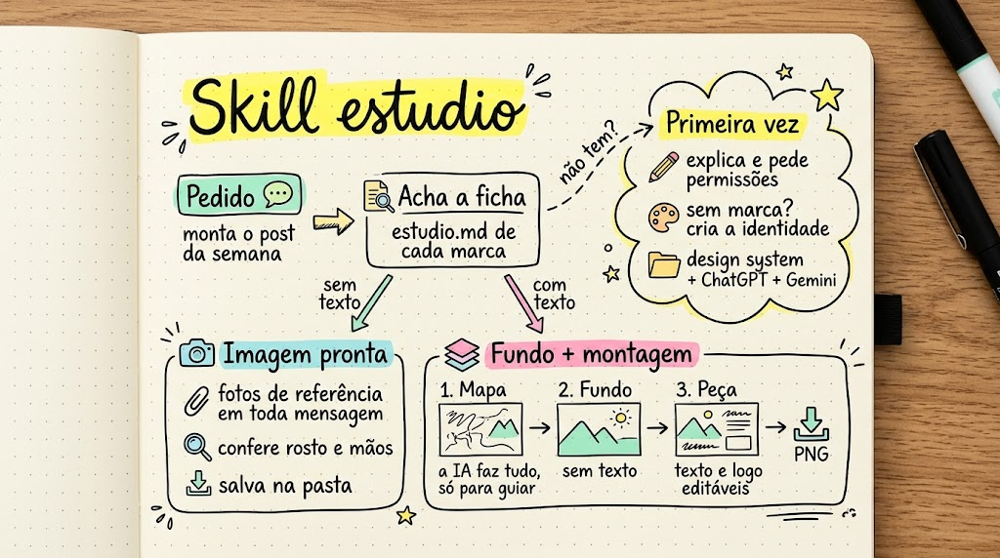
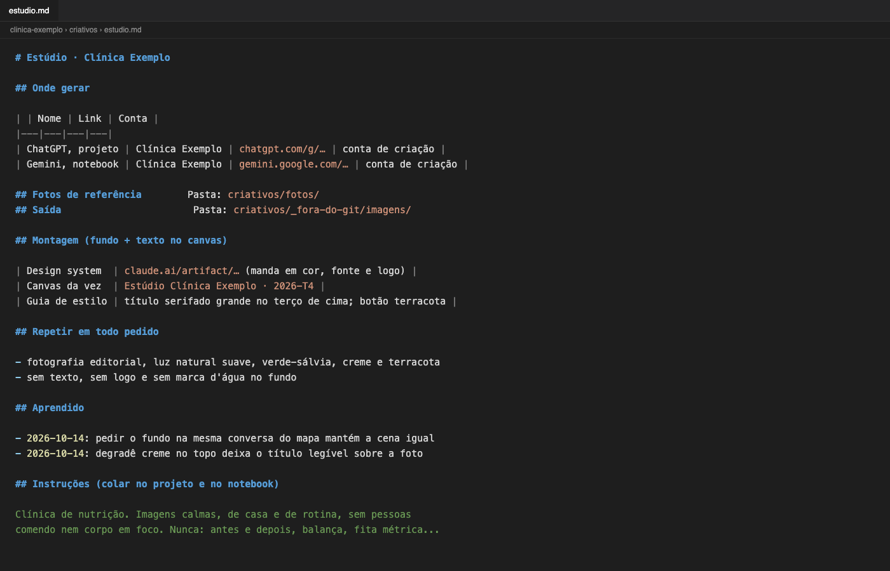
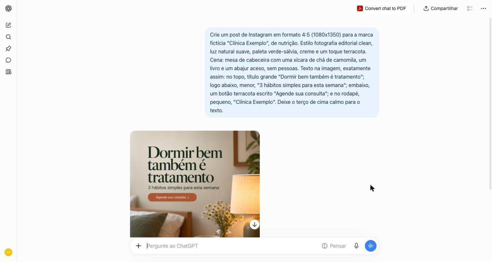
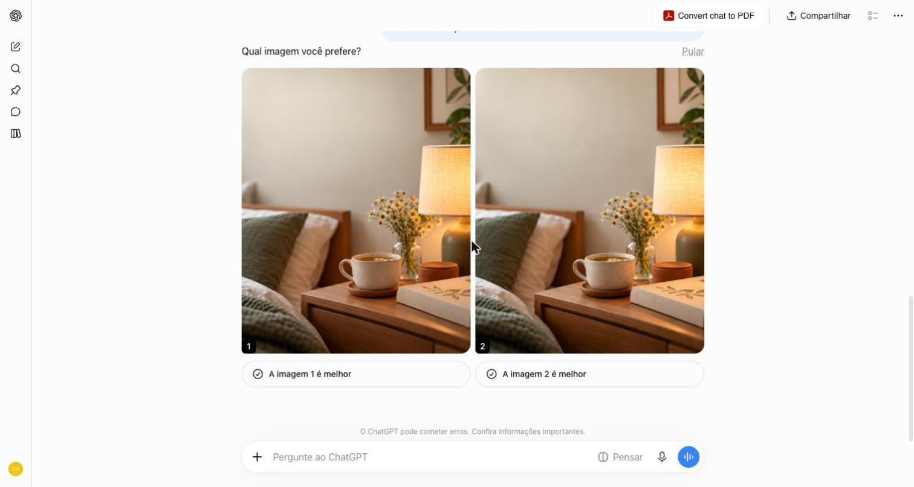
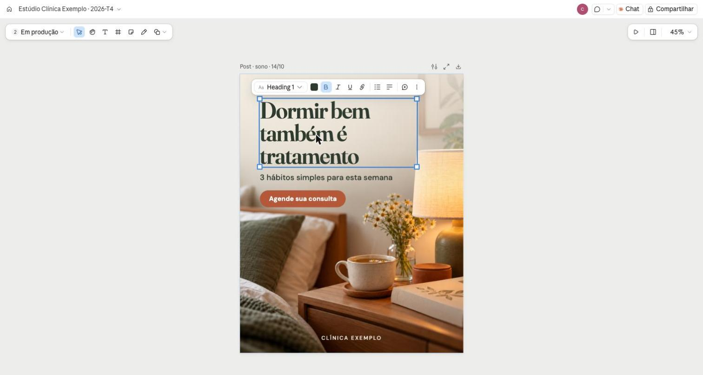

# Skills

Skills para o [Claude Code](https://claude.com/claude-code).

| Skill | O que faz |
|---|---|
| [estudio](#estudio) | Gera imagem e peça de marca no ChatGPT e no Gemini, com a pessoa e a identidade certas |

---

## estudio

Pede imagem ao ChatGPT e ao Gemini como uma pessoa faria, pelo seu navegador,
mas sem esquecer nada: as fotos de referência certas, as cores da marca, o
que não pode aparecer, o tamanho do post. Peça com texto não sai com letra
torta de IA: a IA faz só o fundo, e o texto e a logo entram num canvas
editável.



### Telas

Um post de exemplo, do pedido ao canvas, com a marca fictícia "Clínica
Exemplo".

**1. A ficha da marca.** Projeto, notebook, pastas, design system, o que
repetir em todo pedido e o que já se aprendeu.



**2. O mapa.** A IA gera a peça inteira, com texto, só para servir de
desenho de onde cada coisa fica.



**3. O fundo.** Na mesma conversa, a mesma cena sem nenhuma letra.



**4. A peça no canvas.** O fundo embaixo, texto, botão e marca por cima,
editáveis direto no Claude Design. O mapa fica na página Referência.



### O que ela resolve

- **Rosto que muda a cada imagem.** A skill anexa 2 ou 3 fotos de
  referência em toda mensagem e alterna as fotos entre um pedido e outro.
- **Texto errado dentro da imagem.** No modo fundo + montagem, a IA não
  escreve nada. Título, chamada e logo são montados no canvas do Claude
  Design, e trocar uma palavra é editar, não gerar de novo.
- **Marca que cada um lembra de um jeito.** Cor, fonte e logo moram num
  design system. A skill lê de lá a cada peça, nunca de memória.
- **Começar do zero toda vez.** Cada pessoa ou marca tem uma ficha
  (`estudio.md`) com o projeto do ChatGPT, o notebook do Gemini, as fotos,
  a pasta de saída e o que já se aprendeu ("o cabelo agora é curto", "não
  gerar jaleco").

- **Esperar uma coisa terminar para começar a outra.** O modelo mais
  inteligente (Opus) pensa a peça: ângulo, cena, título, o que vai em cada
  card. O braçal vai para ajudantes mais baratos, em paralelo: o Sonnet
  escreve os textos a partir dessa direção, o Haiku lê o site da marca e
  confere as regras do conselho. Você acompanha cada um no painel do
  Claude Code, e a sessão principal revisa tudo antes de usar. Ajudante
  nunca mexe no navegador. A geração pode correr ao mesmo tempo no
  ChatGPT e no Gemini, uma em cada.

### Quem não tem identidade visual

Se a marca não tem cor, fonte nem logo definidas, a skill monta uma antes:

1. junta o que existe: site, Instagram, prints de cartão, fachada ou post
   antigo, e marcas que a pessoa admira;
2. faz uma entrevista curta, só com o que faltou (três palavras que a marca
   passa, três que não pode passar, cores proibidas, onde aparece);
3. propõe duas direções, com paleta, fontes livres, uso de logo, jeito de
   foto, tom e um post de amostra em cada uma;
4. com a escolhida, cria o design system e a ficha.

É uma identidade para trabalhar, coerente e usável. Símbolo desenhado,
manual completo e registro de marca continuam sendo trabalho de designer.

### Os dois modos

| | Imagem pronta | Fundo + montagem |
|---|---|---|
| Para | foto de site, retrato, banco de imagens | post, carrossel, story, capa, banner |
| A IA gera | a imagem inteira | só o fundo, com área livre para o texto |
| Texto e logo | não tem | no canvas, pelas cores e fontes da marca |
| Corrigir | pedir de novo | editar direto no canvas |

Em peça com texto, a skill pergunta antes: versão completa como rascunho,
só o fundo, ou as duas.

### Instalar

```sh
git clone https://github.com/carlosacvs/skills.git
cp -R skills/estudio ~/.claude/skills/
```

Para usar só num projeto, copie para a pasta `.claude/skills/` dele.
Depois, no Claude Code:

```
/estudio
```

ou peça do seu jeito: "gera uma foto minha no consultório", "monta o
carrossel sobre sono", "cria a identidade visual da clínica".

Na primeira vez, antes de criar qualquer coisa, a skill explica o que vai
fazer, combina com você onde ficam a ficha, as fotos e as imagens geradas,
e lista as permissões que vão aparecer (sites no Claude in Chrome, vários
downloads no Chrome, mover arquivo da pasta Downloads) e para que serve
cada uma. Só segue com o seu ok.

### Precisa de

- Claude Code com a extensão **Claude in Chrome**;
- conta no **ChatGPT** com Projetos e/ou no **Gemini**;
- para o modo fundo + montagem e para o design system, acesso ao
  **Claude Design** no claude.ai.

### Riscos e cuidados

Leia antes de usar.

**Conta de ChatGPT e Gemini.** A skill usa o seu navegador logado para
pedir as imagens. Os termos de uso da OpenAI e do Google restringem o uso
automatizado das versões de chat dos produtos, e as duas empresas podem
limitar, suspender ou encerrar contas que considerem em desacordo. A skill
foi feita para reduzir esse risco: uma geração por vez em cada IA (no
máximo uma no ChatGPT e uma no Gemini ao mesmo tempo), no ritmo de uma
pessoa, com você na sessão, sem lote agendado e sem robô rodando sozinho.
Ela também avisa no começo de cada sessão, sugere pausa depois de 10
imagens somando as duas IAs, avisa antes de pedido grande e **para na hora** se aparecer captcha,
aviso de atividade incomum, limite de uso ou pedido de verificação. O
freio é aviso, não trava: se você mandar seguir, ela segue. Isso
reduz o risco, mas não o elimina, e a decisão de usar é sua.

Por isso, vale considerar uma conta dedicada a esse trabalho, separada da
conta que guarda o seu histórico, seus projetos pessoais e o seu acesso de
todo dia. Se algo acontecer com ela, o resto continua de pé.

**Fotos de pessoas.** Só use foto de quem autorizou o uso da própria
imagem, de preferência por escrito. A skill não reconhece ninguém pelo
rosto e não trabalha com foto sem saber de quem é. As fotos sobem para os
servidores da OpenAI e do Google; confira as configurações de privacidade
e de uso de dados para treino nas duas contas.

**Profissões regulamentadas.** Médico, dentista, nutricionista, psicólogo
e outras profissões têm regras de conselho sobre o que pode aparecer em
publicidade (antes e depois, promessa de resultado, ambiente de
atendimento). A skill segue as regras que o seu repositório trouxer, mas
não as traz prontas. A conferência final é sua.

**Imagem gerada por IA.** Algumas plataformas pedem que conteúdo realista
feito por IA seja identificado. Confira a regra de cada rede antes de
publicar. Logo gerada por IA não deve ser usada como marca para registro.

**Regras do seu repositório vêm primeiro.** Se o seu `CLAUDE.md` ou
`AGENTS.md` exige autorização para abrir link, para gerar ou para salvar
imagem em algum lugar, a skill obedece.

### Em breve

🚧 Próximos passos da skill:

- **Motion**: a peça aprovada vira vídeo curto (7 a 15 s) para story e
  Reels;
- **Todos os formatos de uma vez**: o post aprovado sai também em story
  9:16, quadrado 1:1 e capa 16:9, reaproveitando fundo e texto;
- **Variações para teste de anúncio**: três versões mudando uma coisa só
  (título, fundo ou chamada), já nomeadas para comparar;
- **Acervo**: as imagens geradas com etiquetas, para reaproveitar antes
  de gerar outra.

### Arquivos

| Arquivo | Para quê |
|---|---|
| `estudio/SKILL.md` | o fluxo principal |
| `estudio/identidade.md` | identidade visual para quem não tem |
| `estudio/montagem.md` | fundo + montagem no canvas |
| `estudio/modelo-estudio.md` | modelo da ficha de cada pessoa ou marca |

---

## Licença

[CC BY-NC 4.0](https://creativecommons.org/licenses/by-nc/4.0/): pode usar,
copiar e adaptar, citando o autor (Carlos Sarmento). Não pode vender nem
usar como produto ou serviço pago. Texto completo em [LICENSE](LICENSE).
