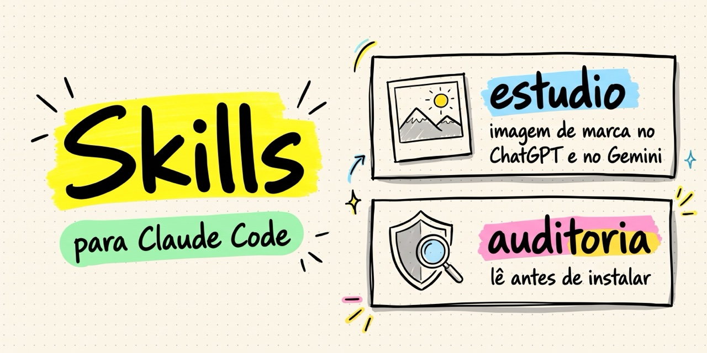

# Skills

Skills em português para o [Claude Code](https://claude.com/claude-code).
Cada pasta é uma skill, com o próprio README: o que faz, do que precisa,
como instalar e os cuidados.

| Skill | O que faz | Onde roda |
|---|---|---|
| [estudio](estudio/) | Gera imagem e peça de marca no ChatGPT e no Gemini, com a pessoa e a identidade certas, e o texto editável no canvas | Claude Code com o Claude in Chrome |
| [auditoria-de-seguranca-antes-de-instalar](auditoria-de-seguranca-antes-de-instalar/) | Lê skill, plugin, repositório ou zip de terceiro sem executar nada e diz se é seguro instalar | Claude Code e claude.ai |

## Instalar

No Claude Code, copie a pasta da skill para `~/.claude/skills/` (vale em
todos os projetos) ou para a pasta `.claude/skills/` de um projeto:

```sh
git clone https://github.com/carlosacvs/skills.git /tmp/skills-atual
cp -R /tmp/skills-atual/<nome-da-skill> ~/.claude/skills/
rm -rf /tmp/skills-atual
```

No claude.ai, compacte a pasta da skill num `.zip` e suba nas
configurações de skills.

## Atualizar

No Claude Code, peça: "atualiza a skill <nome-da-skill> pelo
github.com/carlosacvs/skills". Ou rode no terminal o mesmo comando do
Instalar: ele baixa a versão nova numa pasta temporária, copia por cima e
apaga a temporária. O que mudou em cada versão está no
[CHANGELOG](CHANGELOG.md).

## Antes de instalar qualquer skill

Skill é instrução que o Claude segue com as suas permissões. Leia antes de
instalar, inclusive as daqui. A
[auditoria-de-seguranca-antes-de-instalar](auditoria-de-seguranca-antes-de-instalar/)
existe para isso.

## Licença

[CC BY-NC 4.0](https://creativecommons.org/licenses/by-nc/4.0/): pode usar,
copiar e adaptar, citando o autor (Carlos Sarmento). Não pode vender nem
usar como produto ou serviço pago. Texto completo em [LICENSE](LICENSE).
